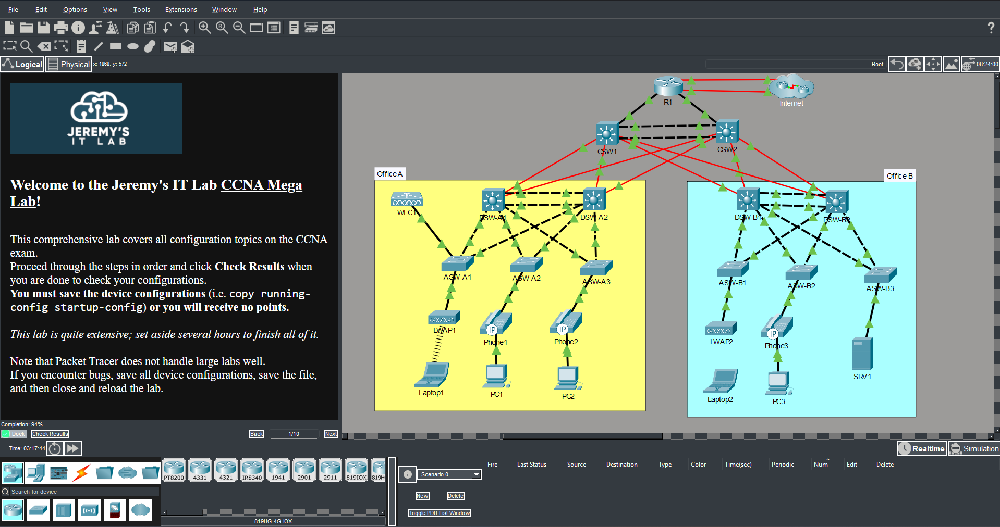

>**نکته**:
> ایده و فایل خام`pka.`این سناریو از [Jeremy's IT Lab](https://youtu.be/2p7-MluKAgE?si=PZIXJnTveFXlKFq1) برداشته شده‼️

# 🔻سناریوی CCNA Mega Lab

## 🔹محیط کار و توپولوژی

Cisco Packet Tracer`9.0.1`⬆️

## 🔹هدف

- انجام دستورالعمل‌های داخل فایل`CCNA Mega Lab (Jeremy's IT Lab).pka`یا`Instructions.pdf`که نوشتم.
    
- **هدف** از این سناریو اینه که تمامی مباحث داخل CCNA رو به صورت یک جا تمرین/مرور/یادآوری کنیم!

## 🔹اقدامات و کانفیگ‌ها

### 🔸چک‌لیست
1. Part 1:
	- [x] Step 1
	- [x] Step 2
	- [x] Step 3
	- [x] Step 4
	
2. Part 2:
	- [x] Step 1
	- [x] Step 2
	- [x] Step 3
	- [x] Step 4
	- [x] Step 5
	- [x] Step 6
	- [x] Step 7
	- [x] Step 8
	- [x] Step 9
	
3. Part 3:
	- [x] Step 1
	- [x] Step 2
	- [x] Step 3
	- [x] Step 4
	- [x] Step 5
	- [x] Step 6
	- [x] Step 7
	- [x] Step 8
	- [x] Step 9
	- [x] Step 10
	- [x] Step 11
	- [x] Step 12
	- [x] Step 13
	- [x] Step 14
	- [x] Step 15
	- [x] Step 16
	- [x] Step 17
	- [x] Step 18
	- [x] Step 19
	
4. Part 4:
	- [x] Step 1
	- [x] Step 2
	
5. Part 5:
	- [x] Step 1
	- [x] Step 2
	
6. Part 6:
	- [x] Step 1
	- [x] Step 2
	- [x] Step 3
	- [x] Step 4
	- [x] Step 5
	- [x] Step 6
	- [x] Step 7
	- [x] Step 8
	- [x] Step 9
	- [x] Step 10
	- [x] Step 11
	- [x] Step 12
	- [x] Step 13
	
7. Part 7:
	- [x] Step 1
	- [x] Step 2
	- [x] Step 3
	- [x] Step 4
	
8. Part 8:
	- [x] Step 1
	- [x] Step 2
	
9. Part 9:
	- [x] Step 1
	- [x] Step 2
	- [x] Step 3
	- [x] Step 4
***
### 🔸کانفیگ‌ها
>**نکته**:
> بخاطر حجم زیاد کانفیگ‌ها، صرفا میتونم Export نهایی هر دستگاه رو بذارم‼️
###### کانفیگ R1

[R1_running-config.txt](Final%20Config%20Files/R1_running-config.txt)

###### کانفیگ CSWs

[CSW1_running-config.txt](Final%20Config%20Files/CSW1_running-config.txt)  
[CSW2_running-config.txt](Final%20Config%20Files/CSW2_running-config.txt)

###### کانفیگ DSWs

[DSW-A1_running-config.txt](Final%20Config%20Files/DSW-A1_running-config.txt)  
[DSW-A2_running-config.txt](Final%20Config%20Files/DSW-A2_running-config.txt)  
[DSW-B1_running-config.txt](Final%20Config%20Files/DSW-B1_running-config.txt)  
[DSW-B2_running-config.txt](Final%20Config%20Files/DSW-B2_running-config.txt)

###### کانفیگ ASWs

[ASW-A1_running-config.txt](Final%20Config%20Files/ASW-A1_running-config.txt)  
[ASW-A2_running-config.txt](Final%20Config%20Files/ASW-A2_running-config.txt)  
[ASW-A3_running-config.txt](Final%20Config%20Files/ASW-A3_running-config.txt)  
[ASW-B1_running-config.txt](Final%20Config%20Files/ASW-B1_running-config.txt)  
[ASW-B2_running-config.txt](Final%20Config%20Files/ASW-B2_running-config.txt)  
[ASW-B3_running-config.txt](Final%20Config%20Files/ASW-B3_running-config.txt)

## 🔹راستی آزمایی
### 🔸پارت 1

### 🔸پارت 2

### 🔸پارت 3

### 🔸پارت 4

### 🔸پارت 5

### 🔸پارت 6

### 🔸پارت 7

### 🔸پارت 8

### 🔸پارت 9

## 🔹مشکل

- **مشکل**م این بود که بعد از اتمام هر 9 پارت، درصدم شد`94%`و به`100%`نرسیدم‼️ 
    
- **راه‌حل**‌ش اینه که ببینم **چرا** از دستوراتم ایراد گرفته شده؛ و ببینم که آیا **تاثیر**ی روی شبکه دارن یا نه✅ 

## 🔹نتیجه

>

